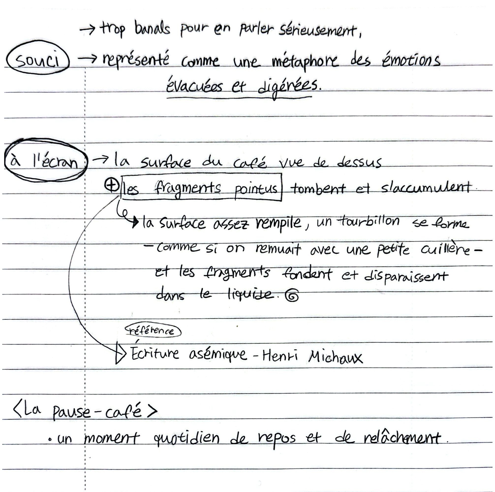
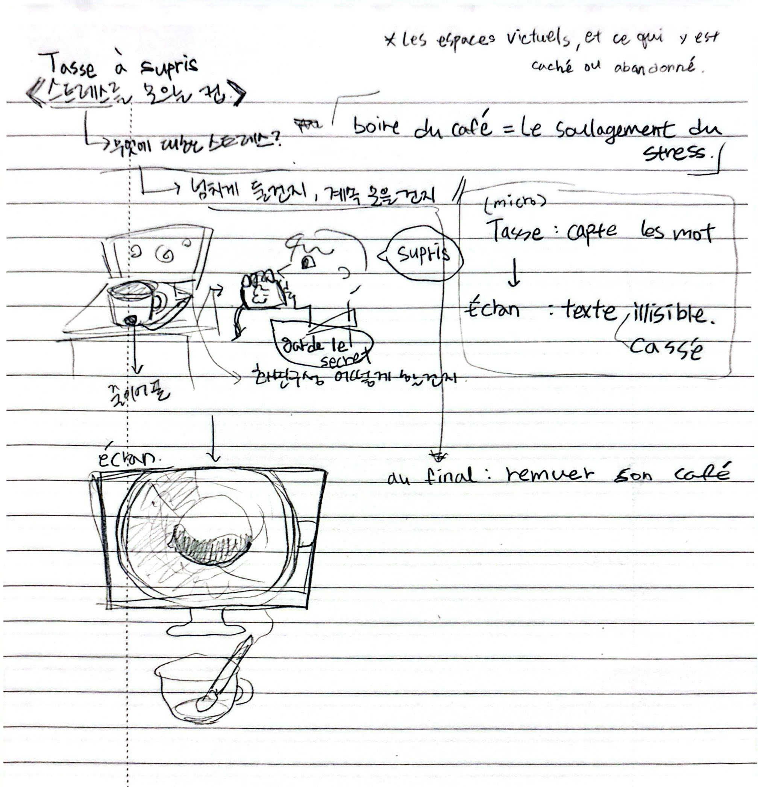

# Fiche Pédagogique

## Informations étudiant·e

- **Nom :** KIM

- **Prénom :** Seryoung

## Profil et connaissances

### Présentation personnelle

- **Objectif à court terme :** Dans ce cours, je souhaite relier un objet réel à un espace virtuel interactif, autour des petits secrets et plaintes du quotidien.
- **Objectif à long terme :** Pour mon diplôme (DNA), je veux continuer à explorer mon thème principal — « les espaces virtuels, et ce qu'on y cache ou abandonne » — à travers des installations interactives simples.

### Compétences

**CODE CRÉATIF**

**GIT ET VERSIONING**

**INTERACTIVITÉ ET RENDU TEMPS RÉEL**

**INSTALLATION ET MISE EN ESPACE**

**PRÉSENTATION ET ARGUMENTATION**

## Projets

### Projet 1

#### Sujet du projet

- **Titre du projet :** Tasse à souci
- **Description du projet (environ 150 mots) :**
    *Tasse à soupirs* est une installation interactive composée d'une tasse vide posée sur une table, équipée d'un petit micro caché, et d'un écran placé devant elle. Le projet part des petits stress du quotidien et de la pause-café comme moment pour les relâcher. Lorsque le visiteur murmure des secrets ou de petites plaintes dans la tasse physique, le micro capte sa voix en temps réel. Sur l'écran — qui montre la surface du café vue de dessus — les mots reconnus tombent et s'accumulent sous forme de fragments pointus, déformés et complètement illisibles. Ainsi, personne ne peut lire ce qui a été dit. Une fois la surface remplie, un tourbillon se forme comme si on remuait avec une cuillère : les fragments fondent doucement dans le café jusqu'à retrouver une surface calme.

#### Thématiques de recherche

- **Thématiques que vous souhaitez explorer :**
La visualisation de l'invisible (la voix) sous de nouvelles formes, et l'interaction entre un objet du quotidien et un écran.

- **Pourquoi cette thématique vous intéresse-t-elle ? (environ 100 mots) :**
Jusqu'ici, j'ai surtout travaillé sur des sujets assez grands, comme des problèmes de société. Pour ce cours, j'ai voulu réduire l'échelle et m'intéresser aux petits stress et aux légères plaintes qu'on a pendant une pause-café. J'avais envie de relier un objet ordinaire à un écran interactif pour créer un petit moment de détente au quotidien. Ce qui m'a aussi intéressée, c'est de rassembler ces soucis mais de les transformer en images illisibles : on peut ainsi exprimer ce qu'on ressent plus librement, sans gêne.

#### Outils et techniques

- **Outils que vous comptez utiliser (logiciels, langages de programmation, etc.) :**
- **Techniques spécifiques que vous souhaitez maîtriser ou expérimenter :**

#### Références artistiques

Golan Levin & Zachary Lieberman, Messa di Voce (2003) : Pour la manière dont la voix captée par un micro se transforme en temps réel en formes abstraites et en fragments visuels qui tombent et s'accumulent à l'écran.

- **Argumentaire expliquant la pertinence de votre projet (environ 150 mots) :**
- **Références artistiques qui inspirent votre travail (livres, artistes, œuvres, etc.) :**

## Actions

### Présentation orale d'un sujet artistique ou design (documentation de recherche)

// Sujet choisi, membres du groupe, date de passage et lien vers votre présentation :

### Accrochage de rendu

// Décrivez ce que vous allez présenter et comment vous comptez le mettre en espace :

### Contribution au logiciel

// Décrivez votre participation à la conception de l'outil commun et votre réflexion sur le sens du logiciel :

## Planification

### Planning de travail

- Établissez un planning des étapes clés de votre projet :
  - **Étape 1 :** date et description
  - **Étape 2 :** date et description
  - **Étape 3 :** date et description

## Commentaires et questions

// Avez-vous des questions ou des préoccupations à propos du cours ou de vos projets ? :

## Journal de bord

Ajoutez une entrée à chaque jour de cours, la plus récente en haut.

### JJ/MM/AAAA

##### 25/11/2026

##### 24/11/2026
- **Ce que j'ai fait :** Rédaction des parties « Présentation personnelle » et « Thématiques de recherche » dans la `fiche_pedagogique.md`, et recherche de références. Échange individuel avec le prof autour de l'installation et mise au clair du mot-clé du projet (passer de « surpris » à « souci »). Début du storyboard pour la maquette vidéo(fake it)
- **Problèmes rencontrés :** Pour fixer la composition de l'écran, il reste plusieurs choix à tester (noir et blanc ou couleurs du café, fragments de texte seuls ou avec des formes abstraites, écran ou vidéoprojection), ainsi que l'outil de reconnaissance vocale (speech-to-text). La maquette vidéo  va servir à tester ces options.
- **Prochaine étape :** Finir le storyboard, rédiger le planning de travail, explorer les outils techniques nécessaires (reconnaissance vocale, choix du micro, etc.) et préparer les visuels d'écran pour tourner la vidéo.
- **Captures / liens :** 

##### 23/11/2026
- **Ce que j'ai fait :** Création du dépôt GitHub public (`DAD-NNN-Seryoung`) et début de la `fiche_pedagogique.md` (rédaction de la description du projet). Courte présentation de l'idée, puis mise au clair du concept et recherche de références.
- **Problèmes rencontrés :** Première utilisation de GitHub Desktop et du Markdown (`.md`), donc j'ai mis un peu de temps à comprendre comment ranger les fichiers et faire des commits. Difficile aussi de développer le projet tout en restant dans ce que je peux coder moi-même. Je me demande encore si je dois vraiment définir un type de stress précis.
- **Prochaine étape :** Remplir les autres parties de la `fiche_pedagogique.md`. Partager à nouveau l'idée précisée avec le prof (reconnaissance vocale + effet de tourbillon dans le café) et lui demander des références.
- **Captures / liens :** [Dépôt GitHub](https://github.com/sukk05/DAD-NNN-Seryoung) 